Here's the full deep-dive in markdown, with architecture diagrams woven in.

---

# Ticketmaster at Scale: Taylor Swift Problem — Full System Design

## Part 1 — The Front Door Problem (Why Everything Breaks First)

Before a single ticket is sold, the system faces a pure physics problem. A Taylor Swift on-sale means ~5 million concurrent users hitting a URL at exactly 10:00:00 AM. The OS kernel on any single server maintains TCP connections in a *listen queue* — a finite buffer. When that overflows, the kernel drops packets. Users see `ERR_CONNECTION_TIMED_OUT` before your application code has even started.

The naive fix — "just add more servers" — doesn't solve it fast enough. DNS propagation is slow, and you still need something in front that can absorb the initial wave *instantly*.

The answer is **Cloudflare as the edge layer**.

### How Cloudflare Actually Works Here

Cloudflare operates a global Anycast network. When your DNS resolves `ticketmaster.com`, BGP routing automatically sends your TCP SYN packet to the **nearest PoP** (Point of Presence) — not to your origin. That PoP is maybe 10ms away instead of 200ms. This is not a CDN cache trick — it's routing-level geography.

At the PoP, Cloudflare runs two things simultaneously:

**1. Rate-gate / capacity signal check.** The PoP holds a locally-cached value: `current_queue_depth`. If `queue_depth > origin_capacity_threshold`, the PoP itself responds with a waiting-room page — a lightweight HTML + polling script. Your origin never sees the request. This is the critical insight: **Cloudflare absorbs the TCP wave. The waiting crowd never touches your servers.**

**2. TLS termination.** Even for users who do get through, Cloudflare terminates TLS at the edge. The origin receives plain HTTP (or mTLS over a private tunnel). This removes TLS handshake CPU from your origin entirely.

The waiting room page served from the PoP is ~3KB of HTML. It contains a JS loop that polls every 10 seconds: `GET /queue/status?token=<user_id>`. This poll goes to the PoP, not the origin. The PoP serves this from local cache. **Zero origin load from waiting users.**

---

## Part 2 — The Virtual Waiting Queue: Deep Internals

This is the core of the whole system. Let's go from first principles.

### The Data Structure: Redis Sorted Set (Z-Set)

### Why a Redis Sorted Set?

A Redis Z-Set stores `(member, score)` pairs and maintains them in score order using a **skip list** internally — O(log N) for insert and rank queries. When User 456 arrives:

```
ZADD queue:event_123 1711234500.123 "user_456"
```

To find their position in line at any moment:

```
ZRANK queue:event_123 "user_456"   → 500200  (0-indexed, so rank 500,201)
```

This is the critical operation. At 5 million users, `ZRANK` still runs in O(log 5,000,000) ≈ 23 comparisons. Sub-millisecond.

### The Leaky Bucket: Protecting Origin Capacity

The "leaky bucket" here is conceptually simple. A background process runs every second:

```
INCR queue:serving_rank:event_123  1000
```

This is an atomic Redis increment — indivisible. It doesn't matter if 10 processes try to run this simultaneously; Redis is single-threaded in its command execution, so only one increment wins per command. The `current_serving_rank` value is a global monotonic truth.

### How the Client Knows It's Their Turn

This is the polling loop, and the design matters enormously.

The waiting room page runs a `setInterval` every 10 seconds:

```js
async function checkPosition() {
  const res = await fetch('/queue/position?event=123&uid=456');
  const { serving_rank, my_rank } = await res.json();
  
  const ahead = my_rank - serving_rank;
  if (ahead <= 0) {
    // It's our turn — redirect with JWT
    window.location.href = `/booking/event_123?token=${res.golden_ticket}`;
  } else {
    const eta = Math.ceil(ahead / 1000); // seconds
    updateUI(`~${eta}s remaining — position ${ahead}`);
  }
}
```

The `/queue/position` endpoint is served by the **Cloudflare Worker** at the edge — not your origin. The Worker reads `current_serving_rank` from a **Cloudflare KV** store (eventually consistent, ~100ms propagation globally). This means:

- **Zero origin requests** for the 4.9M users still waiting
- Each PoP serves position checks from local/regional KV reads
- Only 1000 users/second actually reach origin (those being let through)

When `my_rank <= current_serving_rank`, the Worker issues a **signed JWT** (using an edge-side secret) and redirects the user. This JWT is the "golden ticket" — a cryptographic proof that this user earned their turn.

---

## Part 3 — The Full HLD: From Edge to Database



## Part 4 — The Booking Page: Initial Load & Concurrency

Once the user lands on `/booking/event_123` with their JWT, a new set of problems begins.

### Initial Hydration: The Seat Map Bitmap

50,000 seats. You cannot send 50,000 JSON objects on page load — that's multiple megabytes. Instead, the server sends a **binary bitmap**: one bit per seat.

- Bit `0` = available (green)
- Bit `1` = locked or sold (grey/dark)

50,000 bits = 6,250 bytes ≈ **6KB compressed**. The browser receives this, and a canvas or SVG layer paints the entire stadium map in a single pass. There is no per-seat HTTP request.

### The Real-Time "Pulse": SSE for Seat State Changes

As users interact, seat states change. Every connected browser needs to see these changes without polling. The mechanism is **Server-Sent Events (SSE)** — a persistent HTTP/2 stream from the server to the browser, unidirectional.

```
GET /events/stream?event=123
Accept: text/event-stream

← data: {"seat":"A1","status":"locked","by":"anon"}\n\n
← data: {"seat":"B4","status":"sold"}\n\n
```

The booking server publishes to a Redis pub/sub channel. An SSE gateway process subscribes to that channel and fans the message out to all connected SSE clients for that event.

---

## Part 5 — Concurrency: The Hardest Part

This is where systems die. Two users, one seat, same millisecond. Let's go to first principles.

### Why "Check then Set" Fails

The naive approach:
```
1. SELECT seat WHERE id='A1' AND status='available'  → returns row
2. UPDATE seat SET status='locked' WHERE id='A1'
```

Between step 1 and step 2, another request on another server thread can run the same sequence. Both read "available", both update. **Double booking.** This is a classic TOCTOU (Time-of-Check-Time-of-Use) race condition.

### The Solution: Redis as Single-Threaded Arbiter

Redis processes commands on a **single thread**. No parallelism in command execution. This makes it a perfect serialization point.



We use a **Lua script** — which Redis executes atomically (as a single indivisible unit):

```lua
-- KEYS[1] = "seat:A1"  ARGV[1] = "user_456"  ARGV[2] = fencing_token
local current = redis.call('GET', KEYS[1])
if current == false then
  redis.call('SET', KEYS[1], ARGV[1], 'EX', 600)  -- 10 min lock
  redis.call('SET', KEYS[1]..':token', ARGV[2])
  return 1  -- SUCCESS
else
  return 0  -- ALREADY TAKEN
end
```

Because Lua scripts in Redis are atomic, there is no interleaving possible. User A's script either runs entirely before User B's, or entirely after. The outcome is always deterministic.### Fencing Tokens: Killing the Zombie

The scenario: User A holds a 10-minute lock on Seat A1. Their app server gets hit by a JVM garbage-collection pause for 11 minutes. The lock expires. User B acquires the lock (token `102`). User B pays and writes their booking to PostgreSQL. Now User A's server unfreezes — it still *thinks* it holds the lock (token `101`) and tries to write.

The fix: PostgreSQL only accepts a write if the presented fencing token is **≥ the last token it processed** for that seat:

```sql
UPDATE seats
SET status = 'booked', booked_by = 'user_b', last_token = 102
WHERE seat_id = 'A1' AND last_token < 102;
-- Returns 0 rows updated if token is stale → zombie rejected
```

User A's write with token `101` hits the condition `101 < 102 = false` → zero rows updated → booking rejected. No corruption.

---

## Part 6 — The VPC Security Model



The entire booking system lives inside a **Virtual Private Cloud** with strict subnet isolation. No database is ever reachable from the internet — not even from other subnets without explicit security group rules.The key insight in the security model is **identity-based security groups** rather than IP-based rules. You don't say "accept traffic from `10.0.2.0/24`" — subnets can be reconfigured. Instead you say "accept traffic from any instance with the `app-server` IAM role/SG tag." This means a compromised server in the public subnet can't reach the database even if it somehow knows the DB's private IP.

---

## Full System — Putting It Together in Markdown

```
                  ┌────────────────────────────────────────────────────────────┐
                  │              CLOUDFLARE EDGE LAYER                         │
                  │                                                            │
  5M users ──────▶│  PoP (Mumbai)   PoP (Singapore)   PoP (Frankfurt)  ...    │
  at t=0          │       │                                                    │
                  │       ▼                                                    │
                  │  Rate gate: is origin_capacity saturated?                  │
                  │  YES ──▶ Virtual Waiting Room (served from PoP)            │
                  │         Browser polls /queue/position every 10s            │
                  │         PoP reads serving_rank from Cloudflare KV          │
                  │         When rank ≤ serving_rank → issue signed JWT        │
                  │                                                            │
                  │  NO ──▶ Forward with JWT to origin                         │
                  └──────────────────────┬─────────────────────────────────────┘
                                         │
                  ┌──────────────────────▼─────────────────────────────────────┐
                  │              VPC — APPLICATION LAYER                        │
                  │                                                            │
                  │  [Public subnet]                                           │
                  │    Load balancer  ◀── only port 443, from internet         │
                  │         │                                                  │
                  │  [Private subnet]                                          │
                  │    Booking servers ◀── only from LB security group         │
                  │         │   │                                              │
                  │         │   └──▶ Verify JWT signature                      │
                  │         │        Load seat bitmap (6KB) from cache         │
                  │         │        Open SSE stream for real-time seat state  │
                  │         │                                                  │
                  │         ▼                                                  │
                  │    Redis (atomic Lua script)                               │
                  │         ├── IF seat free → lock (10 min) + fencing token   │
                  │         └── IF locked → return 0 (rejected)                │
                  │                                                            │
                  │  [Queue arbiter service]                                   │
                  │    ZADD queue:event_123 <timestamp> <user_id>              │
                  │    INCR serving_rank +1000 every second                    │
                  │    Push new serving_rank to Cloudflare KV                  │
                  │                                                            │
                  │  [Pub/Sub — Redis channels]                                │
                  │    seat_locked → broadcast to all SSE connections          │
                  │    seat_sold   → broadcast final state                     │
                  └──────────────────────┬─────────────────────────────────────┘
                                         │
                  ┌──────────────────────▼─────────────────────────────────────┐
                  │              DATA LAYER (DB subnet — no internet)           │
                  │                                                            │
                  │  PostgreSQL                                                │
                  │    bookings table: seat_id, user_id, last_token            │
                  │    UPDATE only accepted if token > last_token              │
                  │    (rejects zombie writes)                                 │
                  │                                                            │
                  │  Redis cluster                                             │
                  │    queue sorted set (ZADD/ZRANK)                           │
                  │    seat lock keys with TTL                                 │
                  │    fencing token counters                                  │
                  └────────────────────────────────────────────────────────────┘
```

---

## Key Design Decisions — First Principles Summary

**The waiting room lives at the edge, not origin.** This is the single most important decision. 4.9M waiting users consume zero origin resources — they are talking to Cloudflare KV. Your origin only sees the 1000 users/second it can handle.

**Redis as the serialization arbiter.** Single-threaded command execution makes concurrency safe without distributed locks. The Lua script atomicity guarantee is the foundation of correct seat locking.

**Fencing tokens make clocks irrelevant.** You cannot trust `time.now()` across machines. You can trust a monotonically increasing integer stored in Redis. The database enforces the ordering rule, so no zombie process can corrupt data regardless of how wrong its clock is.

**Security groups on identity, not IP.** Infrastructure changes; IAM roles don't. Attaching rules to roles rather than CIDR blocks makes the perimeter robust to re-deployments and scaling events.

**SSE over WebSockets for seat state.** Seat state changes are server-initiated events — the browser doesn't send updates, it only receives them. SSE is simpler (plain HTTP/2), works through all proxies and load balancers natively, and reconnects automatically. WebSockets add bidirectional complexity you don't need here.